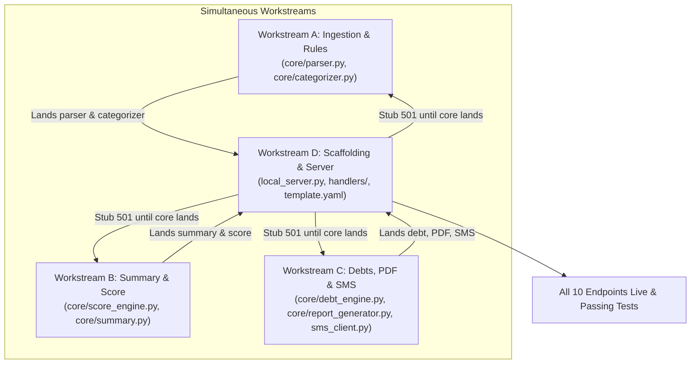

# Biashara Score — Backend Engineering Tasks & Workstreams
**Architecture Specification for Backend Implementation**  
**Sprint Duration:** 15 Days (MVP Delivery)  
**Strict Rule:** No overlapping files across Workstreams A, B, C, and D. Pure business logic in `core/` has zero AWS/boto3 imports.

---

## 1. Parallel Execution Protocol & File Ownership Matrix

All four workstreams (**A, B, C, and D**) run in **parallel**:
- **Workstream D** sets up API routing, CORS, and endpoint scaffolding immediately.
- Any endpoint whose underlying `core/` function has not yet landed will return **HTTP 501 Not Implemented** with standard error envelope `{"error": {"code": "NOT_IMPLEMENTED", "message": "Workstream in progress"}}`.
- As Workstreams A, B, and C land their pure Python core functions, Workstream D connects the real implementations seamlessly without touching core logic files.

| Workstream | Domain | Owned Production Files | Dedicated Test File | Status |
| :--- | :--- | :--- | :--- | :--- |
| **Workstream A** | Ingestion & Categorization | `backend/src/core/parser.py`<br>`backend/src/core/categorizer.py` | `backend/tests/test_parser_categorizer.py` | Parallel |
| **Workstream B** | Scoring & Summary Engines | `backend/src/core/score_engine.py`<br>`backend/src/core/summary.py` *(New)* | `backend/tests/test_score_summary.py` | Parallel |
| **Workstream C** | Debt Engine, PDF & SMS | `backend/src/core/debt_engine.py`<br>`backend/src/core/report_generator.py` *(New)*<br>`backend/src/wrappers/sms_client.py` | `backend/tests/test_debt_report_sms.py` | Parallel |
| **Workstream D** | Handlers, Local Server & Infra | `backend/src/handlers/api_handler.py`<br>`backend/src/handlers/statement_handler.py`<br>`backend/src/handlers/debt_handler.py`<br>`backend/src/handlers/score_handler.py`<br>`backend/src/handlers/cron_handler.py`<br>`backend/local_server.py` *(New)*<br>`backend/src/wrappers/db_client.py`<br>`infra/template.yaml` | `backend/tests/test_api_endpoints.py` | Parallel (501 Stubs) |

---

## 2. Workstream Details & Specifications

### 2.1 Workstream A: Parser & Categorizer Engine
**Primary Domain:** Ingestion of Safaricom CSV statements and SMS strings; rule-based regex classification with Bedrock fallback interface.

#### 2.1.1 Files Owned
- `backend/src/core/parser.py`
- `backend/src/core/categorizer.py`
- `backend/tests/test_parser_categorizer.py`

#### 2.1.2 Required Functions & Type Signatures

```python
# backend/src/core/parser.py
from typing import List, Optional
from .models import Transaction, TransactionDirection, TransactionCategory

def parse_csv_statement(csv_content: str, business_id: Optional[str] = None) -> List[Transaction]:
    """
    Parses a raw Safaricom M-Pesa CSV statement string into a list of Transaction dataclass instances.
    Extracts: receipt_number, completion_time, details, amount, direction, running_balance, status.
    Cleans formatted numbers (e.g., '1,606.98' -> 1606.98) and determines direction ('IN' for Paid In, 'OUT' for Withdrawn).
    """
    ...

def parse_sms_message(sms_text: str, business_id: Optional[str] = None) -> Transaction:
    """
    Parses a single incoming Safaricom M-Pesa SMS message string into a Transaction dataclass instance.
    Extracts receipt code (e.g., 'SK01YUUM7K'), amount, counterparty name/phone, balance, and timestamp.
    """
    ...

def parse_multiple_sms(sms_text: str, business_id: Optional[str] = None) -> List[Transaction]:
    """
    Splits multi-line or concatenated pasted SMS text blocks into individual messages
    and returns a list of parsed Transaction instances.
    """
    ...
```

```python
# backend/src/core/categorizer.py
from typing import Optional, Callable, List
from .models import Transaction, TransactionCategory

def match_rule_based_category(details: str, direction: str) -> Optional[TransactionCategory]:
    """
    Pure regex & keyword dictionary matcher against Kenyan commercial keywords:
    - SALES: Till receipts, Paybill inbound, customer deposits.
    - INVENTORY: Brookside, Pembe, Unga, Bidco, Kapa, Farmer's Choice, Devki, wholesale depots.
    - UTILITIES: KPLC PREPAID, Nairobi Water (NWSC), WiFi, internet.
    - RENT: Landlord transfers, shop rent keywords.
    - OWNER_DRAW: 'Personal Draw', transfers to owner's private numbers.
    - AIRTIME: Airtime Purchase, Safaricom data bundles.
    - DEBT_RECOVERY: 'debt repayment', 'deni', 'debt settled'.
    Returns None if no rule matches with high confidence.
    """
    ...

def categorize_transaction(
    tx: Transaction,
    llm_fallback_fn: Optional[Callable[[str, str, float], str]] = None,
) -> Transaction:
    """
    Categorizes a transaction.
    1. Runs match_rule_based_category. Sets categorization_method = 'RULE_BASED' on match.
    2. If unmatched and llm_fallback_fn is provided, invokes fallback and sets categorization_method = 'BEDROCK_HAIKU'.
    3. If still unmatched, assigns TransactionCategory.UNCATEGORIZED.
    """
    ...

def categorize_batch(
    transactions: List[Transaction],
    llm_fallback_fn: Optional[Callable[[str, str, float], str]] = None,
) -> List[Transaction]:
    """
    Applies categorization across a list of transactions efficiently.
    """
    ...
```

#### 2.1.3 Edge Cases to Handle
1. **CSV Formatting Quarks:**
   - Byte Order Marks (`\xef\xbb\xbf` UTF-8 BOM) at the start of Safaricom CSV exports.
   - Windows CRLF (`\r\n`) vs Unix LF (`\n`).
   - Comma-formatted numbers: `"1,606.98"`, `"50,106.98"`, or trailing empty columns.
   - Rows with empty "Paid In" or "Withdrawn" columns (must not throw `ValueError`).
   - Missing or empty trailing rows in the CSV export.
2. **SMS Format Variations:**
   - Standard receipt: `"SK01YUUM7K Confirmed. You have received Ksh1,600.00 from..."`
   - Lipa na M-Pesa Buy Goods: `"You have sent Ksh2,479.42 to Bidco Africa Distributors..."`
   - Paybill payment: `"Ksh1,500.00 sent to KPLC PREPAID for account 1428392019..."`
   - Airtime purchase: `"You bought Ksh300.00 of airtime on 4/9/26..."`
   - Multi-message paste with double newlines, dashes, or numbered lists.
3. **Keyword Collision:**
   - "Jane Wanjiku" paying till vs "Farmer's Choice" paying till. Inbound to Till is always `SALES` unless note indicates `DEBT_RECOVERY`.
   - "Airtime" keywords within customer names must not falsely trigger `AIRTIME` category.

#### 2.1.4 "Done When" Test Scenario
**File:** `backend/tests/test_parser_categorizer.py`  
**Assertions:**
1. Loads `sample-data/mpesa_statement.csv` (150 rows).
2. `parse_csv_statement()` returns exactly 150 `Transaction` objects without exceptions.
3. First transaction has `receipt_number == "SK01YUUM7K"`, `amount == 1606.98`, `direction == TransactionDirection.IN`.
4. `categorize_batch()` categorizes:
   - Row 1 (`Till payment - John Otieno`) as `TransactionCategory.SALES`.
   - Row 6 (`Landlord Joseph Njuguna Shop Rent`) as `TransactionCategory.RENT`.
   - Row 10 (`Bidco Africa Distributors`) as `TransactionCategory.INVENTORY`.
   - Row 14 (`Airtime Purchase`) as `TransactionCategory.AIRTIME`.
5. Rule-based categorization coverage on `sample-data/mpesa_statement.csv` achieves **≥ 95%** without needing LLM fallback.
6. `parse_multiple_sms()` successfully parses a 3-SMS multi-block text and returns 3 valid `Transaction` records.
7. **Messy Hand-Written Edge Case Test Suite:** Test suite contains 10 realistic, hand-written Kenyan transactions *not* in the sample CSV to stress-test noisy inputs:
   - `B101`: `"B101 Confirmed. Ksh 450.00 paid to KPLC PREPAID for account 1428392019 via Paybill 888880 on 12/9/26."` -> `UTILITIES`
   - `B102`: `"B102 Confirmed. You have sent Ksh3,200.00 to Unga Limited 222111 on 12/9/26."` -> `INVENTORY`
   - `B103`: `"B103 Confirmed. You have received Ksh 850.00 from John Kamau 0712345678 on 12/9/26."` -> `SALES`
   - `B104`: `"B104 Confirmed. Ksh500.00 of airtime bought on 13/9/26 at 8:00 AM."` -> `AIRTIME`
   - `B105`: `"B105 Confirmed. Transfer of Ksh12,000.00 to Landlord Mutua for Duka Rent Oct on 13/9/26."` -> `RENT`
   - `B106`: `"B106 Confirmed. Ksh 2,000.00 sent to Self / Personal Draw Mama Mary on 13/9/26."` -> `OWNER_DRAW`
   - `B107`: `"B107 Confirmed. Received Ksh 1,100.00 from Dennis Omondi deni ya unga cleared on 14/9/26."` -> `DEBT_RECOVERY`
   - `B108`: `"B108 Confirmed. Ksh 4,500.00 sent to Brookside Dairies Milk Supplies on 14/9/26."` -> `INVENTORY`
   - `B109`: `"B109 Confirmed. Ksh 650.00 paid to Nairobi City Water and Sewerage on 15/9/26."` -> `UTILITIES`
   - `B110`: `"B110 Confirmed. Received Ksh 350.00 from Mama Boi 0728192837 for sukuma wiki on 15/9/26."` -> `SALES`  
   *All 10 must parse and categorize accurately without raising exceptions.*

---

### 2.2 Workstream B: Financial Summary & Score Engine
**Primary Domain:** 4-week moving average sales, expenses, net profit, and the 4-pillar Biashara Credit Scoring algorithm.

#### 2.2.1 Files Owned
- `backend/src/core/score_engine.py`
- `backend/src/core/summary.py` *(New File)*
- `backend/tests/test_score_summary.py`

#### 2.2.2 Required Functions & Type Signatures

```python
# backend/src/core/summary.py
from typing import List, Dict, Any, Optional
from datetime import datetime
from .models import Transaction, TransactionCategory, WeeklySummary

def calculate_weekly_summary(
    transactions: List[Transaction],
    start_date: Optional[str] = None,
    end_date: Optional[str] = None
) -> Dict[str, Any]:
    """
    Computes weekly totals from a list of transactions:
    - gross_sales: Sum of 'IN' transactions categorized as SALES or DEBT_RECOVERY.
    - operating_expenses: Sum of 'OUT' transactions categorized as INVENTORY, UTILITIES, RENT, AIRTIME.
    - estimated_profit: gross_sales - operating_expenses.
    - profit_margin_pct: (estimated_profit / gross_sales) * 100 (0.0 if gross_sales == 0).
    - active_trading_days: Distinct calendar dates with at least 1 sales transaction.
    - expense_breakdown: Dict mapping category to total spend.
    - pulse_message: Formatted summary string ("You made KSh 14,200 this week, profit KSh 3,100.").
    """
    ...

def calculate_multi_week_series(
    transactions: List[Transaction],
    num_weeks: int = 4,
    reference_date: Optional[str] = None
) -> List[Dict[str, Any]]:
    """
    Groups transactions into calendar weeks (ISO week numbering) for the trailing num_weeks.
    Returns chronological list of weekly summary dicts for trend visualization.
    """
    ...
```

```python
# backend/src/core/score_engine.py
from typing import List, Dict, Any
from .models import Transaction, DebtRecord, BiasharaScoreResult

def compute_consistency_score(transactions: List[Transaction]) -> int:
    """
    Pillar 1 (Max 30 pts): Income Consistency & Frequency.
    Evaluates:
    - Trading days per week (>5 days/week = full points).
    - Regularity of daily deposits.
    """
    ...

def compute_growth_score(weekly_summaries: List[Dict[str, Any]]) -> int:
    """
    Pillar 2 (Max 25 pts): Revenue Volume & Growth.
    Evaluates:
    - Average monthly turnover (>KSh 40,000 for typical duka).
    - Week-over-week growth trajectory.
    """
    ...

def compute_margin_score(weekly_summaries: List[Dict[str, Any]]) -> int:
    """
    Pillar 3 (Max 25 pts): Operating Margin & Expense Ratio.
    Evaluates net operating margin: (Sales - Operating Expenses) / Sales.
    - 15% to 35% margin = 25 pts.
    - 5% to 14% margin = 15 pts.
    - Negative margin = 0 pts.
    """
    ...

def compute_debt_recovery_score(debts: List[DebtRecord]) -> int:
    """
    Pillar 4 (Max 20 pts): Debt Discipline & Recovery.
    Evaluates:
    - Total recovered / total credit extended (>80% recovery = full points).
    - Presence of delinquent debts older than 30 days.
    - If no debts extended (zero credit shop), returns 15/20 neutral baseline.
    """
    ...

def generate_actionable_tips(
    consistency: int,
    growth: int,
    margin: int,
    debt: int,
    debts: List[DebtRecord]
) -> List[str]:
    """
    Produces 2-4 concrete, contextual tips in plain Kenyan English to help the shopkeeper improve their score.
    """
    ...

def calculate_biashara_score(
    business_id: str,
    transactions: List[Transaction],
    debts: List[DebtRecord],
) -> BiasharaScoreResult:
    """
    Computes total score (0 to 100) = consistency + growth + margin + debt.
    Assigns tier ('Gold', 'Silver', 'Bronze', 'Needs Improvement').
    """
    ...
```

#### 2.2.3 Edge Cases to Handle
1. **Zero Transactions (Cold Start):** Returns valid `BiasharaScoreResult` with score 0, tier `"Needs Improvement"`, without `ZeroDivisionError`.
2. **Negative Profit Weeks:** High restocking week handled cleanly; margin score clamped to 0.
3. **Out-of-Order Timestamps:** Correct grouping using ISO timestamps.
4. **Zero Extended Debts:** Neutral baseline (15/20) without division-by-zero errors.

#### 2.2.4 "Done When" Test Scenario
**File:** `backend/tests/test_score_summary.py`  
**Assertions:**
1. Evaluates transactions from `sample-data/mpesa_statement.csv`.
2. `calculate_multi_week_series()` yields 4 consecutive weekly summaries with valid sales, expenses, and positive net profits.
3. `calculate_biashara_score()` produces:
   - `0 <= total_score <= 100`
   - `total_score == consistency_score + growth_score + expense_ratio_score + debt_recovery_score`
   - `tier in ["Gold", "Silver", "Bronze", "Needs Improvement"]`
   - `len(actionable_tips) >= 2`
4. Executes with empty lists without throwing `ZeroDivisionError`.

---

### 2.3 Workstream C: Debt Engine, PDF Report & SMS Client
**Primary Domain:** Reconciliation of incoming customer payments with open debts, ReportLab PDF generation, and Africa's Talking SMS integration.

#### 2.3.1 Files Owned
- `backend/src/core/debt_engine.py`
- `backend/src/core/report_generator.py` *(New File)*
- `backend/src/wrappers/sms_client.py`
- `backend/tests/test_debt_report_sms.py`

#### 2.3.2 Required Functions & Type Signatures

```python
# backend/src/core/debt_engine.py
from typing import List, Optional, Tuple, Dict, Any
from .models import DebtRecord, Transaction, DebtStatus

def normalize_phone_number(phone: str) -> str:
    """
    Standardizes Kenyan phone numbers to E.164:
    '0712345678' -> '+254712345678'
    '254712345678' -> '+254712345678'
    """
    ...

def match_repayment_to_debt(
    tx: Transaction,
    open_debts: List[DebtRecord]
) -> Optional[Tuple[DebtRecord, float]]:
    """
    Matches incoming payment to an open debt via normalized phone or debtor name substring.
    """
    ...

def apply_debt_repayment(
    debt: DebtRecord,
    payment_amount: float,
    receipt_number: str,
    payment_date: str,
    notes: str = ""
) -> DebtRecord:
    """
    Decrements balance_remaining (capped at 0.0), updates status, and appends to repayment_history.
    """
    ...

def calculate_debt_metrics(debts: List[DebtRecord]) -> Dict[str, Any]:
    """
    Calculates aggregate metrics: total_outstanding_amount, total_cleared_amount, recovery_rate_pct, etc.
    """
    ...
```

```python
# backend/src/core/report_generator.py
from typing import Dict, Any, List
from .models import BiasharaScoreResult

def generate_lender_pdf(
    business_profile: Dict[str, Any],
    score_result: BiasharaScoreResult,
    weekly_summaries: List[Dict[str, Any]],
    debt_summary: Dict[str, Any],
) -> bytes:
    """
    Generates a single-page A4 PDF financial verification report using ReportLab.
    Returns binary PDF bytes (b'%PDF-...').
    """
    ...
```

```python
# backend/src/wrappers/sms_client.py
from typing import Dict, Any
import os

def build_weekly_sms_message(
    owner_name: str,
    week_label: str,
    sales: float,
    expenses: float,
    profit: float,
    outstanding_debts: float,
    score: int,
    tier: str
) -> str:
    """
    Constructs the Safaricom-compliant SMS digest string:
    'Habari Mary! Biashara Score Summary for W36: Sales KSh 38,450, Expenses KSh 26,800, Est. Profit KSh 11,650. Outstanding Debts: KSh 3,200. Score: 78/100 (Silver). Keep growing!'
    """
    ...

class AfricaTalkingSMSClient:
    def send_sms(self, phone_number: str, message: str) -> Dict[str, Any]:
        """
        Dispatches SMS via Africa's Talking API (prints to stdout when MOCK_AWS=true).
        """
        ...
```

#### 2.3.3 Edge Cases to Handle
1. **Phone Normalization:** Unifies `07...`, `01...`, `254...`, `+254...`.
2. **Overpayment & Partial Payments:** Capping cleared balance at 0.0, updating status `PARTIAL` vs `CLEARED`.
3. **Pure-Python PDF Generation:** Uses ReportLab standard canvas with zero OS-level binary dependencies.
4. **SMS Character Length:** Clean number formatting with commas and no ugly floating decimals.

#### 2.3.4 "Done When" Test Scenario
**File:** `backend/tests/test_debt_report_sms.py`  
**Assertions:**
1. Tests matching sample statement row `SK067BQRKW` against a sample `DebtRecord`:
   - Matches by phone.
   - Reduces `balance_remaining` to 0.0 and sets status to `DebtStatus.CLEARED`.
2. Tests `generate_lender_pdf()`:
   - Returns bytes starting with `b"%PDF-"` and size > 3,000 bytes.
3. Tests `build_weekly_sms_message()`:
   - Formats correctly and stays ≤ 200 characters.
4. `sms_client.send_sms()` succeeds in mock mode without errors.

---

### 2.4 Workstream D: Handlers, Local Server & SAM Routes
**Primary Domain:** Thin AWS Lambda adapters, local FastAPI mock server with CORS for `http://localhost:3000`, database client wrapper updates, and `template.yaml` routing.

> [!IMPORTANT]
> **Parallel Scaffolding & 501 Stubs:** Workstream D implements all route contracts immediately. Any route awaiting core implementations from Workstream A, B, or C will return **HTTP 501 Not Implemented**. As core functions land, Workstream D wires them up without touching core files.

#### 2.4.1 Files Owned
- `backend/src/handlers/api_handler.py`
- `backend/src/handlers/statement_handler.py`
- `backend/src/handlers/debt_handler.py`
- `backend/src/handlers/score_handler.py`
- `backend/src/handlers/cron_handler.py`
- `backend/local_server.py` *(New File)*
- `backend/src/wrappers/db_client.py`
- `infra/template.yaml`
- `backend/tests/test_api_endpoints.py`

#### 2.4.2 Required Implementations & Signatures

```python
# backend/src/wrappers/db_client.py (Extended methods needed by handlers)
class DatabaseClient:
    def put_transaction(self, tx_dict: Dict[str, Any]) -> None: ...
    def batch_put_transactions(self, tx_dicts: List[Dict[str, Any]]) -> None: ...
    def get_transactions_for_business(self, business_id: str, limit: int = 100) -> List[Dict[str, Any]]: ...
    def put_debt(self, debt_dict: Dict[str, Any]) -> None: ...
    def get_debts_for_business(self, business_id: str) -> List[Dict[str, Any]]: ...
    def get_debt_by_id(self, business_id: str, debt_id: str) -> Optional[Dict[str, Any]]: ...
    def update_debt(self, business_id: str, debt_id: str, updates: Dict[str, Any]) -> Dict[str, Any]: ...
    def get_business(self, business_id: str) -> Optional[Dict[str, Any]]: ...
    def put_business(self, business_dict: Dict[str, Any]) -> None: ...
```

```python
# backend/local_server.py (FastAPI App with CORS)
from fastapi import FastAPI, UploadFile, File, Header, HTTPException, Query
from fastapi.middleware.cors import CORSMiddleware
from fastapi.responses import Response

app = FastAPI(title="Biashara Score Local API", version="1.1.0")

app.add_middleware(
    CORSMiddleware,
    allow_origins=["http://localhost:3000", "http://127.0.0.1:3000"],
    allow_credentials=True,
    allow_methods=["*"],
    allow_headers=["*"],
)

# Implements all REST endpoints matching docs/API_CONTRACT.md exactly
# Unimplemented core functions return HTTP 501:
# raise HTTPException(status_code=501, detail={"error": {"code": "NOT_IMPLEMENTED", "message": "Pending core module"}})
```

#### 2.4.3 "Done When" Test Scenario
**File:** `backend/tests/test_api_endpoints.py`  
**Assertions:**
1. Tests `GET /health`: returns HTTP `200` with `status == "healthy"`.
2. Tests `GET /business` and `PUT /business`: updates and fetches business metadata.
3. Tests `POST /statements/upload` and `POST /statements/sms`: de-duplicates by receipt_number and returns `{imported, skipped_duplicates, debts_auto_matched}`.
4. Tests `GET /transactions`, `GET /summary/weekly`, `POST /debts`, `GET /debts`, `PATCH /debts/{id}`, `GET /score`, `GET /reports/lender-pdf`, `POST /notifications/weekly-sms`.
5. Validates CORS headers for `Origin: http://localhost:3000`.

---

## 3. Parallel Execution Strategy & Coordination



---

## 4. Architecture & Implementation Risks and Mitigations

| # | Risk Description | Severity | Impact | Concrete Mitigation |
| :- | :--- | :---: | :---: | :--- |
| **R-1** | **Safaricom Statement Format Inconsistency:** M-Pesa CSV exports occasionally vary headers or date formats between consumer app and business portal. | **High** | Parser failure during duka onboarding. | Implement resilient header normalization in `parser.py` (case-insensitive strip, fuzzy column matching). Support multiple datetime formats. |
| **R-2** | **Bedrock LLM Latency & Cost Spill:** Ambiguous transactions sent sequentially to Bedrock Claude 3 Haiku could slow down statement upload. | **Medium** | Slow upload response (>15s), higher AWS bills. | The rule engine must handle ≥95% of transactions locally. Fallback to default heuristic if Bedrock call exceeds 2 seconds. |
| **R-3** | **ReportLab Lambda Package Size & Cold Start:** PDF libraries can introduce bloated dependencies. | **Medium** | Lambda packaging errors or deployment bloat. | Use standard `reportlab` with built-in fonts only. Keep Lambda package < 35MB. |
| **R-4** | **Debt Reconciliation False Positives:** A customer might send an M-Pesa payment for a new cash purchase that accidentally gets credited against an old debt. | **Medium** | Incorrect debt clearing in "Kitabu ya Deni". | Require explicit matching heuristics (normalized phone + amount/details check). Expose manual update endpoint `PATCH /debts/{id}`. |
| **R-5** | **SMS Gateway Latency & Failures:** Africa's Talking API timeouts during scheduled Sunday 8:00 PM cron run. | **Low** | Weekly SMS not delivered on time. | Add a 5-second timeout on SMS HTTP requests, log delivery status in DynamoDB, and decouple cron calculation from SMS sending. |
| **R-6** | **Local Server vs Lambda Parity Drift:** Discrepancy between FastAPI behavior locally and API Gateway + Lambda in AWS. | **Medium** | Works on developer machine but fails when Dev 4 deploys to staging. | Keep Lambda handlers paper-thin: handlers only translate API Gateway events and call the exact same `core/` functions that `local_server.py` calls. |
